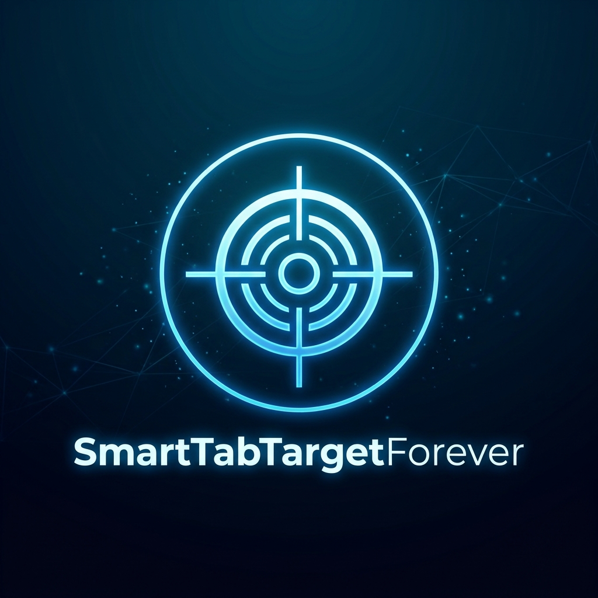

# SmartTabTargetForever

  

Um único recurso, bem pequeno para o **WoW Forever** (Interface `16001`): em **zonas PvP**, a tecla `TAB` mira o **jogador inimigo mais próximo** (e `SHIFT-TAB` o anterior), em vez de ciclar alvos normais.

## O que faz

- Ao entrar em instância PvP (`IsInInstance() == "pvp"`), ativa os overrides de tecla:
  - `TAB` → `TARGETNEARESTENEMYPLAYER`
  - `SHIFT-TAB` → `TARGETPREVIOUSENEMYPLAYER`
- Ao sair, restaura o comportamento normal de `TAB`.
- Reage a `PLAYER_ENTERING_WORLD` e `ZONE_CHANGED_NEW_AREA`.

## Requisitos

- WoW Forever (Interface `16001`), locale pt-BR.

## Instalação

Extraia o ZIP da [Release](../../releases) em `World of Warcraft\_forever_\Interface\AddOns\`. Deve ficar `AddOns\SmartTabTargetForever\`. `/reload`.

## /smarttab — menu

Use **`/smarttab`** (alias **`/stt`**) para abrir a janela de configuração
(`SmartTabTargetForeverMainFrame`). Hoje a janela tem uma aba, **Sobre**:

- **O que é** — o que o addon faz (TAB → inimigo mais próximo em instâncias PvP).
- **Como usar** — nada a configurar; aba diz o comando para abrir esta janela.
- **Créditos** — Marcus (criação e direção) e Inkling 2 Small Free (OpenCode) como
  parceiro de desenvolvimento; derivado do SmartTabTarget (WotLK).

## Origem

Derivado do SmartTabTarget (WotLK), reescrito para o cliente moderno do Forever. **Marcus** — criação e direção; desenvolvido com assistência de IA.

## Licença

MIT — ver `LICENSE`.
